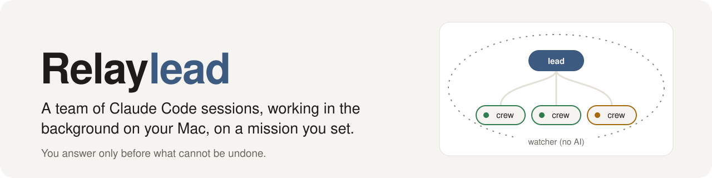
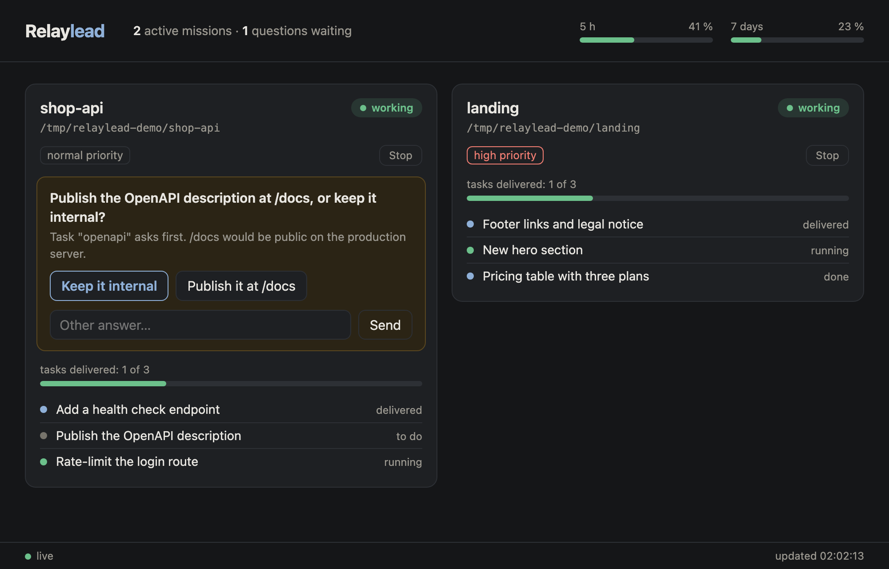

<p align="right"><a href="README.md">English</a> · <strong>Français</strong></p>

<picture>
  <source media="(prefers-color-scheme: dark)" srcset="https://raw.githubusercontent.com/jawharmed/relaylead/main/docs/assets/banner-dark.svg">
  
</picture>

<p>
  <a href="https://www.npmjs.com/package/relaylead"></a>
  <a href="https://github.com/jawharmed/relaylead/actions/workflows/ci.yml"></a>
  <a href="LICENSE"></a>
  
  
</p>

**Relaylead est un outil open source en ligne de commande, accompagné d'un plugin Claude Code, qui fait travailler une équipe de sessions Claude Code en arrière-plan sur une mission, sous macOS.** Une session lead découpe le travail en tâches, des sessions équipières les réalisent, chacune sur sa propre branche git, et un veilleur sans IA relance ou réveille ce qui s'arrête. On ne vous pose une question qu'avant un geste irréversible, et rien n'arrive sur votre branche tant que vous ne l'avez pas fusionné.

## Pourquoi Relaylead

Mener plusieurs sessions Claude Code à la main, c'est les surveiller sans cesse : relancer celle qui est tombée, réveiller celle qui s'est endormie, garder en tête qui fait quoi.

Avec Relaylead, vous écrivez les tâches (ou la console les écrit avec vous), vous lancez la mission, et vous passez à autre chose :

- **Un lead planifie et livre.** Il lance un équipier par tâche, relance un échec, fusionne chaque tâche finie dans la branche d'intégration propre à la mission, et vous dit quand la mission est terminée.
- **Les équipiers travaillent chacun de leur côté.** Chacun a son worktree git et sa branche : ils ne se marchent pas dessus, et ne touchent pas à votre copie de travail.
- **Un veilleur fait avancer le tout.** Une petite boucle sans IA, maintenue en vie par launchd, relance un lead arrêté, réveille celui qui a du nouveau, et passe la main à un lead neuf quand le contexte se remplit.
- **Vous décidez de ce qui ne se défait pas.** Une livraison ratée, une tâche marquée « demander d'abord », une commande risquée : le lead vous pose la question, avec des options numérotées, et attend. Une notification Mac vous prévient.
- **Vos limites d'usage sont respectées.** Relaylead lit votre usage Claude sur 5 heures et sur 7 jours, et met une mission en pause avant qu'elle n'entame le reste de votre semaine.

## Démarrage rapide

Il vous faut un Mac, Node.js 18 ou plus, `git`, et Claude Code connecté. Les détails sont dans [Prérequis](#prérequis).

1. **Installez Relaylead.**

   ```sh
   npm install -g relaylead
   relaylead install        # le veilleur en arrière-plan et le plugin Claude Code
   ```

2. **Ouvrez Claude Code dans votre projet et faites confiance au dossier.**

   ```sh
   cd ~/code/mon-projet     # la racine d'un dépôt git
   claude
   ```

   Claude Code vous demande si vous faites confiance au dossier. Choisissez **Yes, I trust this folder**. La réponse proposée par défaut, *No, exit*, refuse, et aucune mission ne peut démarrer dans un dossier auquel Claude Code ne fait pas confiance.

3. **Tapez `/relaylead` et dites ce que vous voulez.** Par exemple : `/relaylead ajoute une route de santé et un fichier LICENSE`. La conversation devient la console : elle prépare le projet la première fois, écrit avec vous un fichier de tâche par morceau de travail, les commite, puis lance la mission.

4. **Répondez aux questions, puis fusionnez.** Chaque question du lead s'affiche dans la conversation telle qu'il l'a posée, avec le nom de la mission. Quand la mission est terminée, la console vous demande s'il faut fusionner le travail dans votre branche, et ne le fait que si vous dites oui.

Vous préférez le terminal ? La même mission, sans Claude Code ouvert :

```sh
relaylead init                                   # une fois par machine, puis une fois par projet
mkdir -p tasks && $EDITOR tasks/sante.md         # un fichier Markdown par tâche
git add tasks && git commit -m "Ajoute les tâches" # les équipiers partent des commits
relaylead launch --request "Réalise les tâches"  # affiche le nom de la mission
relaylead brief                                  # questions et avancement, sans IA
relaylead merge mon-projet                       # une fois la mission terminée
```

[Premiers pas](docs/fr/getting-started.md) déroule une mission complète, avec chaque commande et ce qu'elle affiche.

## La voir tourner

`relaylead dashboard` sert une page locale qui se met à jour toute seule. Ici, deux missions tournent en même temps, et l'une attend une réponse :



Le même état s'affiche dans la ligne d'état de Claude Code (`relaylead · 2 missions · ❓1 · quota 5 h 41 %`), dans un panneau à côté de la conversation (`/pane`), et dans le terminal :

```text
$ relaylead brief
Rien de nouveau.
Questions ouvertes (1) :
[shop-api] q-openapi: Publier la description OpenAPI sur /docs, ou la garder interne ?
  La tâche « openapi » demande d'abord. /docs serait public sur le serveur de production.
  1. La garder interne (recommandée)
  2. La publier sur /docs
Missions en cours :
  landing: working · tâches 1/3 livrées (1 running, 1 done) · priorité high
  shop-api: working · tâches 1/3 livrées (1 running)
```

## Ce que ça coûte

Relaylead est gratuit. Les sessions utilisent votre abonnement Claude ou votre clé API, comme n'importe quelle session Claude Code.

- **Le lead tourne sur Opus, les équipiers sur Sonnet**, tous en effort moyen. Le veilleur n'utilise aucun modèle.
- **Mesuré :** une vraie mission de deux petites tâches a coûté environ **0,60 $ au tarif public de l'API**, dont les trois quarts pour le lead (Opus 5.5 et Sonnet 5.5, novembre 2026). Avec un abonnement, cela compte dans votre usage sur 5 heures et 7 jours, et Relaylead met les missions en pause avant vos limites.
- **Regardez gratuitement, décidez dans la console.** `relaylead brief`, la page web et la ligne d'état lisent des fichiers locaux et ne coûtent rien. La console `/relaylead` est une conversation Claude : en ouvrir une coûte de 0,30 à 0,46 $ au tarif API d'Opus, surtout pour le démarrage de Claude Code lui-même. Servez-vous-en pour écrire des missions et répondre aux questions, pas pour suivre l'avancement.

Le détail et la façon dont ces chiffres ont été mesurés : [Coûts](docs/fr/costs.md).

## La sécurité, sans enjoliver

Les sessions tournent sans personne devant l'écran. Relaylead les entoure donc de garde-fous :

- les outils de fichiers d'un équipier n'écrivent que dans son propre worktree, et ne peuvent pas ouvrir les clés SSH, les identifiants cloud, vos réglages Relaylead ni l'état des missions ;
- les pushs vers les branches protégées (`main`, `master`), les pushs forcés, les commits sur une branche protégée et les fichiers secrets (`.env` et compagnie) sont refusés quel que soit le mode de permission ;
- les commandes irréversibles (`git reset --hard`, une suppression récursive hors du worktree) attendent votre réponse ;
- les équipiers n'ont que les commandes de leur profil, et le travail reste sur les branches de Relaylead jusqu'à ce que vous lanciez `relaylead merge`.

**Ces garde-fous arrêtent les erreurs d'un agent de bonne foi. Ils n'arrêtent pas un agent détourné**, par exemple par des instructions cachées dans une issue GitHub. Un équipier peut lancer `node`, `git` et vos scripts de test, et chacun d'eux peut passer outre une règle écrite pour les outils de Claude Code. Le jeton de la page web peut être lu par n'importe quel processus de votre Mac. Pour traiter des issues écrites par des inconnus, utilisez un compte macOS ou une machine qui ne contient aucun secret.

Le modèle de menace complet, et ce qui reste possible : [Sécurité](docs/fr/safety.md).

## Ce que Relaylead écrit chez vous

| Où | Quoi | Dans git ? |
| --- | --- | --- |
| `~/.relaylead/` | Les réglages de la machine, l'état de chaque mission, les journaux, le fichier de clé API si vous en utilisez une. Réservé à votre compte. | Non, c'est hors de votre projet. |
| `.relaylead.json` | Les réglages du projet, écrits par `init`. Aucun secret n'y est mis. | À vous de voir : commitez-le pour partager les réglages avec votre équipe. |
| `.relaylead/` | Les worktrees des tâches en cours, et la mémoire du projet (`memory.md`). | Non : Relaylead l'ajoute à `.git/info/exclude`. Votre `.gitignore` n'est jamais modifié. |
| Branches `relaylead/<mission>/…` | Une branche par tâche, et `relaylead/<mission>/integration` avec le travail livré. | Branches locales. Celles des tâches disparaissent une fois livrées. |
| `~/Library/LaunchAgents/dev.relaylead.watcher.plist` | L'agent launchd du veilleur, ajouté par `relaylead install`. | Non. |

Une mission ne modifie jamais votre copie de travail : le travail arrive sur la branche d'intégration, et seul `relaylead merge` l'amène dans votre branche.

## Prérequis

- **macOS.** Le veilleur repose sur launchd, et Relaylead n'est testé que sous macOS.
- **Node.js 18 ou plus** et **`git`**.
- **Claude Code 2.1.325 ou plus**, connecté avec un abonnement qui inclut Claude Code (Pro, Max, Team ou Enterprise), ou configuré avec une clé API Anthropic (`relaylead init --api-key-env NOM`).
- **`gh`**, la ligne de commande GitHub, connectée, seulement pour prendre les tâches dans des issues GitHub et livrer par pull request.

`relaylead doctor` vérifie tout cela et dit quoi corriger.

## Documentation

| Page | Pour |
| --- | --- |
| [Premiers pas](docs/fr/getting-started.md) | Votre première mission, pas à pas, avec ce que vous verrez. |
| [Guide](docs/fr/guide.md) | La référence : glossaire, toutes les commandes et options, tous les réglages. |
| [Fonctionnement](docs/fr/how-it-works.md) | Des schémas : une mission, les rôles, les branches git, la console. |
| [Sécurité](docs/fr/safety.md) | Ce que les garde-fous arrêtent, ce qu'ils n'arrêtent pas, et comment s'installer prudemment. |
| [Coûts](docs/fr/costs.md) | Les modèles utilisés, les coûts mesurés, comment dépenser moins. |
| [FAQ](docs/fr/faq.md) | Les questions courantes et le dépannage. |
| [Changelog](CHANGELOG.md) (en anglais) | Ce qui change à chaque version, et comment mettre à jour. |

## Désinstaller

```sh
relaylead uninstall --purge   # veilleur, plugin et ~/.relaylead (refusé tant qu'une mission tourne)
npm uninstall -g relaylead
```

Les branches et worktrees de vos projets restent. Le [guide](docs/fr/guide.md#désinstaller) explique comment les retirer aussi.

## Contribuer et licence

Les signalements de bugs et les pull requests sont bienvenus : voir [CONTRIBUTING.md](CONTRIBUTING.md) (en anglais). Signalez les failles de sécurité en privé, comme l'indique [SECURITY.md](SECURITY.md).

Licence MIT, par Lilia Digital.
