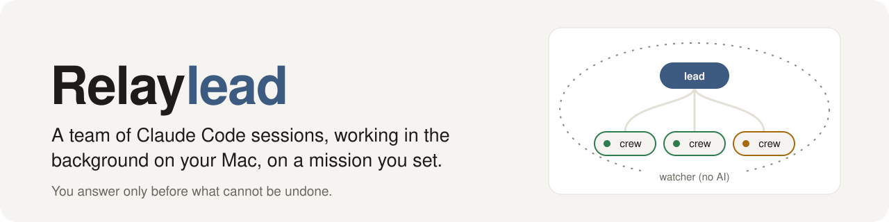
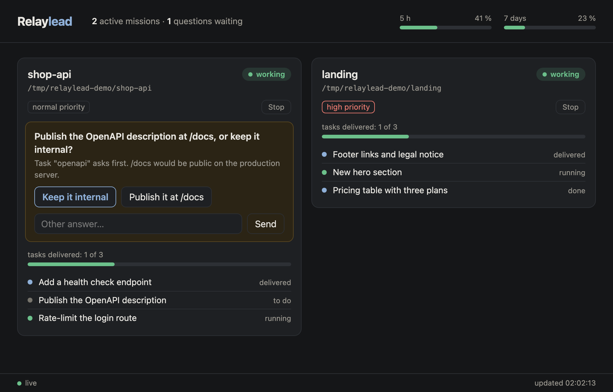

<p align="right"><strong>English</strong> · <a href="README.fr.md">Français</a></p>

<picture>
  <source media="(prefers-color-scheme: dark)" srcset="https://raw.githubusercontent.com/jawharmed/relaylead/main/docs/assets/banner-dark.svg">
  
</picture>

<p>
  <a href="https://www.npmjs.com/package/relaylead"></a>
  <a href="https://github.com/jawharmed/relaylead/actions/workflows/ci.yml"></a>
  <a href="LICENSE"></a>
  
  
</p>

**Relaylead is an open-source command-line tool and Claude Code plugin for macOS that runs a team of Claude Code sessions in the background on a mission.** A lead session splits the work into tasks, crew sessions carry them out, each on its own git branch, and a watcher with no AI restarts or wakes whatever stops. You are asked a question only before something that cannot be undone, and nothing reaches your branch until you merge it.

## Why Relaylead

Running several Claude Code sessions by hand means babysitting them: you restart the one that died, nudge the one that stalled, and keep track of who does what.

With Relaylead you write the tasks (or let the console write them with you), launch the mission, and go do something else:

- **A lead plans and delivers.** It starts one crew member per task, retries a failure, merges each finished task into the mission's own integration branch, and tells you when the mission is done.
- **Crew members work apart.** Each one has its own git worktree and branch, so they never step on each other or on your checkout.
- **A watcher keeps it moving.** A small loop with no AI, kept alive by launchd, restarts a lead that stopped, wakes one that has news waiting, and hands over to a fresh lead when the context fills up.
- **You decide what cannot be undone.** A failed delivery, a task marked "ask first", a risky command: the lead asks, with numbered options, and waits. You get a Mac notification.
- **Usage limits are respected.** Relaylead reads your 5-hour and 7-day Claude usage and pauses a mission before it eats the rest of your week.

## Quick start

You need a Mac, Node.js 18 or newer, `git`, and Claude Code signed in. [Requirements](#requirements) has the details.

1. **Install Relaylead.**

   ```sh
   npm install -g relaylead
   relaylead install        # the background watcher and the Claude Code plugin
   ```

2. **Open Claude Code in your project and trust the folder.**

   ```sh
   cd ~/code/my-project     # the root of a git repository
   claude
   ```

   Claude Code asks whether you trust the folder. Choose **Yes, I trust this folder**. The default answer, *No, exit*, refuses, and missions cannot start in a folder Claude Code does not trust.

3. **Type `/relaylead` and say what you want.** For example: `/relaylead add a health check endpoint and a LICENSE file`. The conversation becomes the console: it sets the project up the first time, writes one task file per piece of work with you, commits them, and launches the mission.

4. **Answer the questions, then merge.** Each question the lead asks shows up in the conversation as it was asked, with the mission's name. When the mission is done, the console asks whether to merge the work into your branch, and merges only on your yes.

Prefer the terminal? The same mission without Claude Code open:

```sh
relaylead init                                   # once per machine, then once per project
mkdir -p tasks && $EDITOR tasks/health.md        # one Markdown file per task
git add tasks && git commit -m "Add tasks"       # crew members work from commits
relaylead launch --request "Carry out the tasks" # prints the mission's name
relaylead brief                                  # questions and progress, no AI involved
relaylead merge my-project                       # once the mission is done
```

[Getting started](docs/getting-started.md) walks through a complete mission, with every command and what it prints.

## See it work

`relaylead dashboard` serves a local page that refreshes on its own. Here, two missions run at once; one waits for an answer:



The same state is in the Claude Code status line (`relaylead · 2 missions · ❓1 · quota 5 h 41 %`), in a panel next to the conversation (`/pane`), and in the terminal:

```text
$ relaylead brief
Nothing new.
Open questions (1):
[shop-api] q-openapi: Publish the OpenAPI description at /docs, or keep it internal?
  Task "openapi" asks first. /docs would be public on the production server.
  1. Keep it internal (recommended)
  2. Publish it at /docs
Missions not over:
  landing: working · tasks 1/3 delivered (1 running, 1 done) · priority high
  shop-api: working · tasks 1/3 delivered (1 running)
```

## What it costs

Relaylead itself is free. The sessions use your Claude plan or your API key, like any Claude Code session.

- **The lead runs on Opus, crew members on Sonnet**, both at medium effort. The watcher uses no model at all.
- **Measured:** a real mission with two small tasks used about **$0.60 at API list prices**, three quarters of it for the lead (Opus 5.5 and Sonnet 5.5, November 2026). On a subscription, it counts toward your 5-hour and 7-day usage instead, and Relaylead pauses missions before your limits.
- **Look for free, decide in the console.** `relaylead brief`, the web page and the status line read local files and cost nothing. The `/relaylead` console is a Claude conversation: opening one costs about $0.30 to $0.46 at Opus API prices, most of it Claude Code's own start-up. Use it to write missions and answer questions, not to check progress.

Details and the method behind these numbers: [Costs](docs/costs.md).

## Safety, honestly

Sessions run with nobody watching, so Relaylead puts guardrails around them:

- a crew member's file tools write only inside its own worktree, and cannot open SSH keys, cloud credentials, your Relaylead settings or the missions' state;
- pushes to protected branches (`main`, `master`), forced pushes, commits on protected branches and secret files (`.env` and friends) are refused in every permission mode;
- irreversible commands (`git reset --hard`, a recursive delete outside the worktree) wait for your answer;
- crew members get only the commands of their profile, and the work stays on Relaylead's branches until you run `relaylead merge`.

**These guardrails stop the mistakes of an agent acting in good faith. They do not stop an agent that has been hijacked**, for example by instructions hidden in a GitHub issue. A crew member may run `node`, `git` and your test scripts, and any of those can reach past a rule written for Claude Code's own tools. The dashboard's token can be read by any process on your Mac. To work on issues written by strangers, use a macOS account or a machine that holds no secrets.

Read [Safety](docs/safety.md) for the full threat model and what remains possible.

## What Relaylead writes on your machine

| Where | What | In git? |
| --- | --- | --- |
| `~/.relaylead/` | Machine settings, the state of each mission, logs, the API key file if you use one. Private to your account. | No, it is outside your project. |
| `.relaylead.json` | The project's settings, written by `init`. No secret goes in it. | Your choice: commit it to share the settings with your team. |
| `.relaylead/` | Worktrees of the running tasks, and the project memory (`memory.md`). | No: Relaylead adds it to `.git/info/exclude`. Your `.gitignore` is never touched. |
| `relaylead/<mission>/…` branches | One branch per task, and `relaylead/<mission>/integration` with the delivered work. | Local branches. Task branches go away once delivered. |
| `~/Library/LaunchAgents/dev.relaylead.watcher.plist` | The launchd agent of the watcher, added by `relaylead install`. | No. |

Your checkout is never changed by a mission: the work lands on the integration branch, and only `relaylead merge` brings it into your branch.

## Requirements

- **macOS.** The watcher relies on launchd, and Relaylead is tested on macOS only.
- **Node.js 18 or newer** and **`git`**.
- **Claude Code 2.1.325 or newer**, signed in with a plan that includes Claude Code (Pro, Max, Team or Enterprise), or set up with an Anthropic API key (`relaylead init --api-key-env NAME`).
- **`gh`**, the GitHub CLI, signed in, only to take tasks from GitHub issues and deliver pull requests.

`relaylead doctor` checks all of this and says what to fix.

## Documentation

| Page | For |
| --- | --- |
| [Getting started](docs/getting-started.md) | Your first mission, step by step, with what you will see. |
| [Guide](docs/guide.md) | The reference: glossary, every command and option, every setting. |
| [How it works](docs/how-it-works.md) | Diagrams of a mission, the roles, git branches and the console. |
| [Safety](docs/safety.md) | What the guardrails stop, what they do not, and how to set up safely. |
| [Costs](docs/costs.md) | Which models run, measured costs, how to spend less. |
| [FAQ](docs/faq.md) | Common questions and troubleshooting. |
| [Changelog](CHANGELOG.md) | What changed in each version, and how to update. |

## Uninstall

```sh
relaylead uninstall --purge   # watcher, plugin and ~/.relaylead (refused while a mission is running)
npm uninstall -g relaylead
```

Branches and worktrees in your projects stay. The [guide](docs/guide.md#uninstalling) explains how to remove them too.

## Contributing and license

Bug reports and pull requests are welcome: see [CONTRIBUTING.md](CONTRIBUTING.md). Report vulnerabilities privately as described in [SECURITY.md](SECURITY.md).

MIT license, by Lilia Digital.
