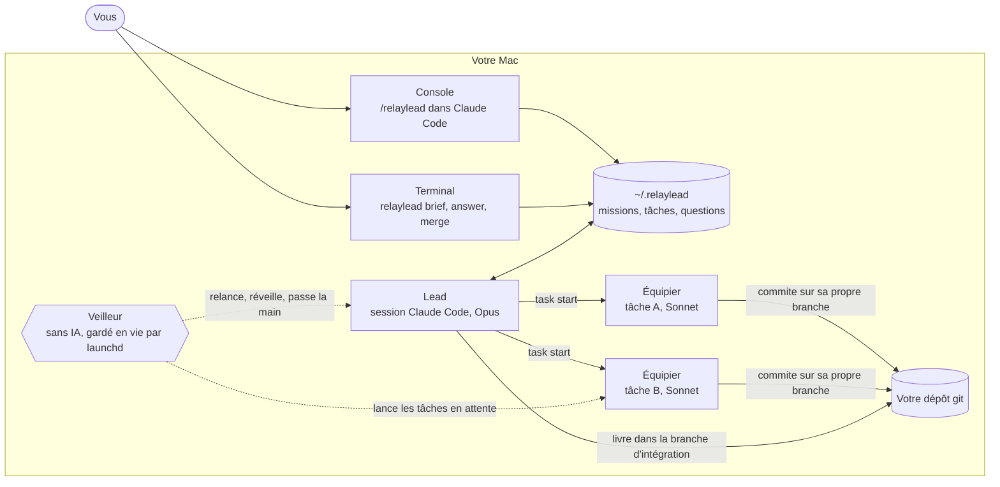
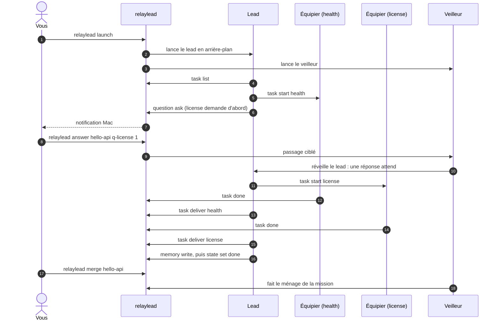
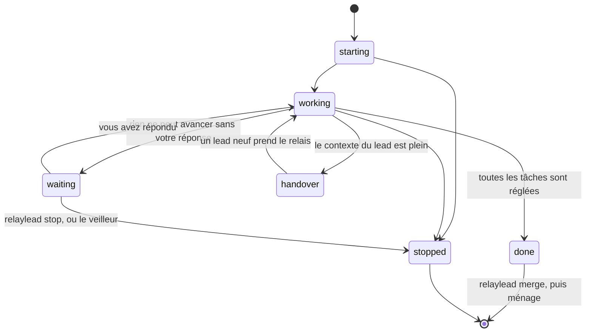
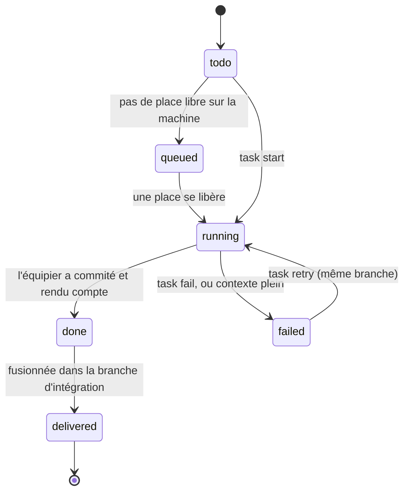
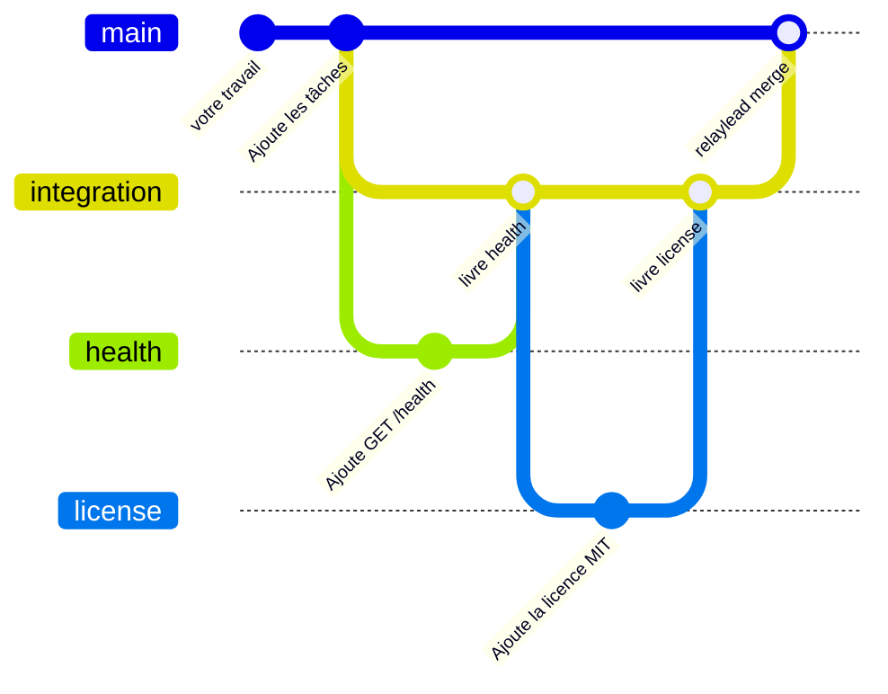
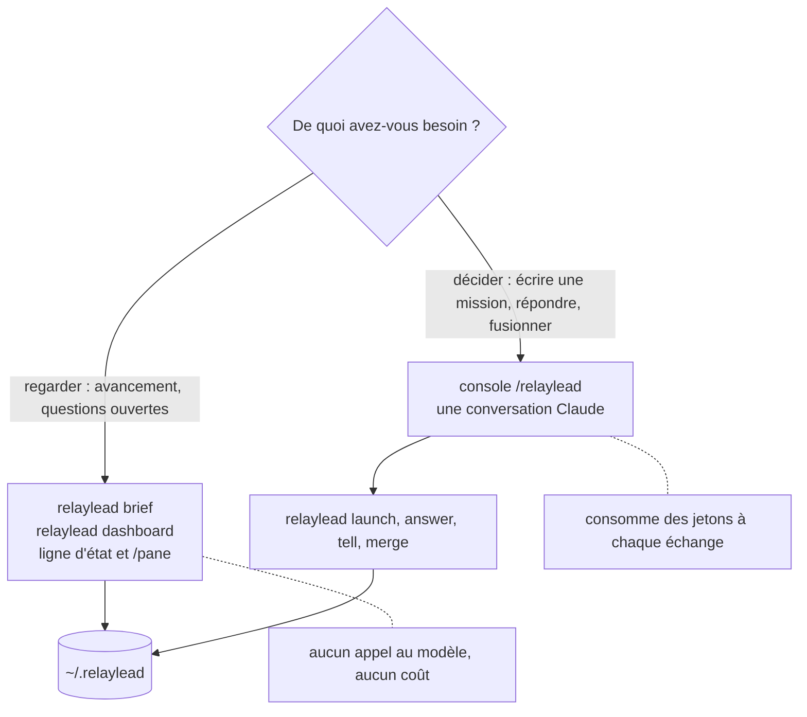

<a href="../how-it-works.md">English</a> · <strong>Français</strong>

# Comment fonctionne Relaylead

Relaylead est un outil en ligne de commande (`relaylead`) qui lance et surveille des sessions Claude Code en arrière-plan (`claude --bg`). Il range tout son état dans de simples fichiers sous `~/.relaylead` : une session, une conversation ou le Mac entier peut s'arrêter et repartir sans que la mission soit perdue. Cette page montre les rouages en schémas. Les mots sont définis dans le [glossaire](guide.md#glossaire).

## Vue d'ensemble

- **Vous** parlez à Relaylead par la console (une conversation Claude Code) ou par le terminal. Les deux lancent les mêmes commandes `relaylead`.
- **Le lead** est une session Claude Code par mission. Il ne touche jamais au code : il lit les tâches, lance les équipiers, livre leur travail et vous pose des questions, uniquement par des commandes `relaylead`.
- **Les équipiers** sont des sessions Claude Code éphémères, une par tâche, chacune dans son worktree et sur sa branche.
- **Le veilleur** est une simple boucle Node.js, sans IA. Il veille à ce que le lead soit vivant et réveillé quand quelque chose l'attend.
- **Les fichiers** de `~/.relaylead` sont la seule source de vérité. Un lead neuf les lit et reprend là où le précédent s'est arrêté.

## Une mission du début à la fin

L'[exemple de Premiers pas](getting-started.md#une-mission-complète-depuis-le-terminal) : deux tâches, `health` et `license`, et `license` pose d'abord une question.

Chaque équipier travaille seul : il lit sa tâche, modifie le code, lance les tests du projet, commite sur sa branche, et termine par `relaylead task done` (ou `task fail` avec la raison). Le lead livre une tâche terminée en fusionnant sa branche dans la branche d'intégration, ce qui rend prêtes les tâches qui en dépendent.

## États des missions et des tâches

Une mission :

Une tâche :

Une tâche avec `ask` reste `todo` jusqu'à votre réponse. « Skip this task » la met de côté pour de bon.

## Branches et worktrees

Chaque mission travaille sur ses propres branches : votre copie de travail n'est jamais touchée pendant qu'elle tourne. Voici l'exemple vu dans git (les vrais noms de branches sont `relaylead/hello-api/integration`, `relaylead/hello-api/health` et `relaylead/hello-api/license`) :

- La branche d'intégration part de la branche d'où vous avez lancé la mission, avec son worktree dans `.relaylead/worktrees/<mission>/_integration/`.
- Chaque tâche reçoit une branche issue de la branche d'intégration et un worktree dans `.relaylead/worktrees/<mission>/<tâche>/`. Les outils de fichiers d'un équipier ne peuvent écrire que là.
- Livrer une tâche fusionne sa branche dans la branche d'intégration, puis retire le worktree et la branche de la tâche.
- `relaylead merge` fusionne la branche d'intégration dans votre branche. En cas de conflit, il annule la fusion, et un équipier résout d'abord le conflit sur une branche à lui.
- Les opérations git de missions différentes sur un même dépôt passent à tour de rôle, sous verrou.

## Le veilleur

Le veilleur est une boucle de règles simples, sans modèle et sans aucun jeton dépensé. launchd le garde en vie à travers les redémarrages du Mac ; `relaylead launch` le lance aussi. Un passage a lieu toutes les 5 minutes, et un court passage ciblé suit chaque événement (une réponse, une tâche finie, un message).

| Il voit | Il fait |
| --- | --- |
| Un lead arrêté | Le relance : la même session si son contexte est faible, sinon une session neuve qui repart des fichiers. |
| Un lead qui a fini son tour alors qu'une réponse, une tâche finie ou un message l'attend | Le réveille. |
| Un lead dont le contexte est plein | Lance un lead neuf et arrête l'ancien une fois qu'il a noté où en sont les choses. |
| Un second lead, ou une session d'équipier dont la tâche ne tourne plus | L'arrête. |
| Une place libre sur la machine et des tâches en attente | Lance la tâche en attente de la mission la plus prioritaire. |
| Un usage au-dessus du seuil de la mission, ou une limite d'usage | Met la mission en pause et la reprend à l'heure de réinitialisation. |
| 3 relances ratées à la suite, ou une erreur de facturation ou d'authentification | Arrête la mission, dit pourquoi et vous prévient. |
| Une mission terminée dont la branche d'intégration a été fusionnée ou supprimée | Retire son état, ses worktrees et ses branches de tâches. |

Tout ce qu'il fait est noté dans `~/.relaylead/watcher.log`. Un fichier vide `~/.relaylead/STOP` le met au repos jusqu'à ce que vous le supprimiez.

## La console et le terminal

La console et le terminal atteignent les mêmes fichiers. La différence, c'est le coût : la console est une conversation Claude, alors que `brief`, la page web et la ligne d'état se contentent de lire des fichiers.

La console attend les événements avec `relaylead wait --all`, lancé comme commande d'arrière-plan : Claude Code ne réveille la conversation que lorsqu'il se passe quelque chose. Une mission qui tourne une heure ne coûte donc rien dans la console pendant ce temps. [Coûts](costs.md#la-console-face-à-brief-et-à-la-page-web) donne les chiffres mesurés.

## Où l'état est rangé

| Quoi | Où |
| --- | --- |
| Réglages de la machine | `~/.relaylead/config.json` |
| État, tâches, questions, décisions, messages et journal d'une mission | `~/.relaylead/missions/<mission>/` |
| Journal du veilleur | `~/.relaylead/watcher.log` |
| Réglages du projet | `.relaylead.json` dans le projet |
| Mémoire du projet | `.relaylead/memory.md` dans le projet |
| Travail en cours | `.relaylead/worktrees/<mission>/` et les branches `relaylead/<mission>/…` |

Toutes les écritures sont atomiques et protégées par des verrous qui portent le numéro du processus détenteur : deux commandes ne corrompent jamais un fichier, et un verrou laissé par un processus mort est repris. La liste complète est dans [Fichiers et dossiers](guide.md#fichiers-et-dossiers).
