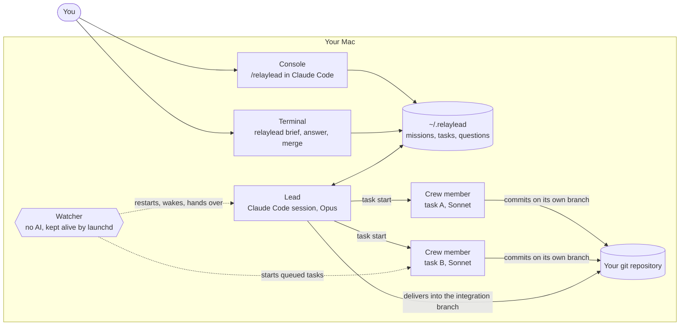
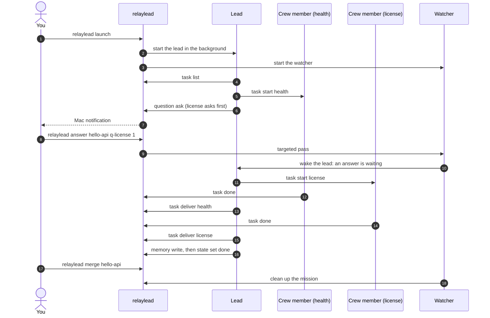
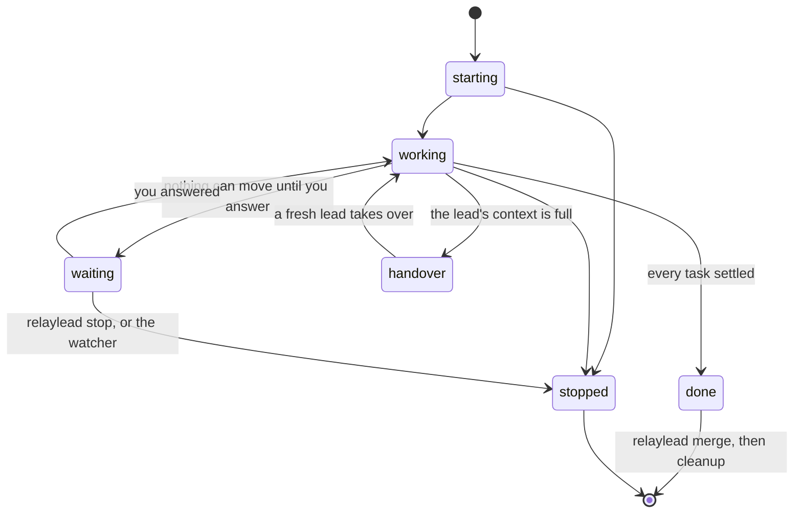
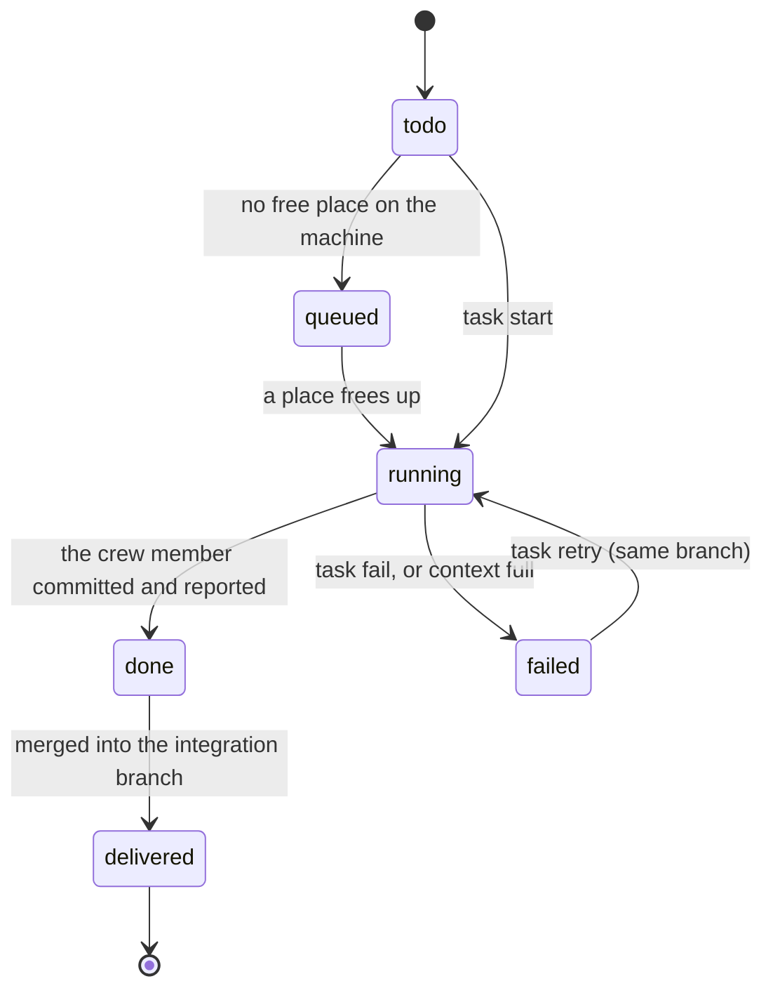
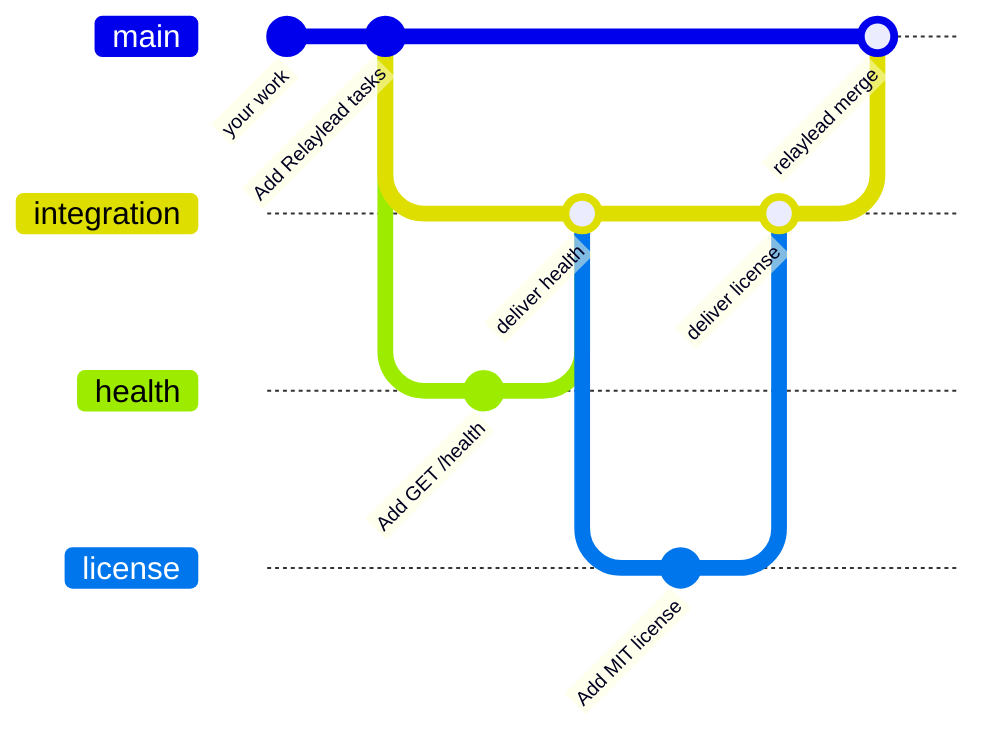
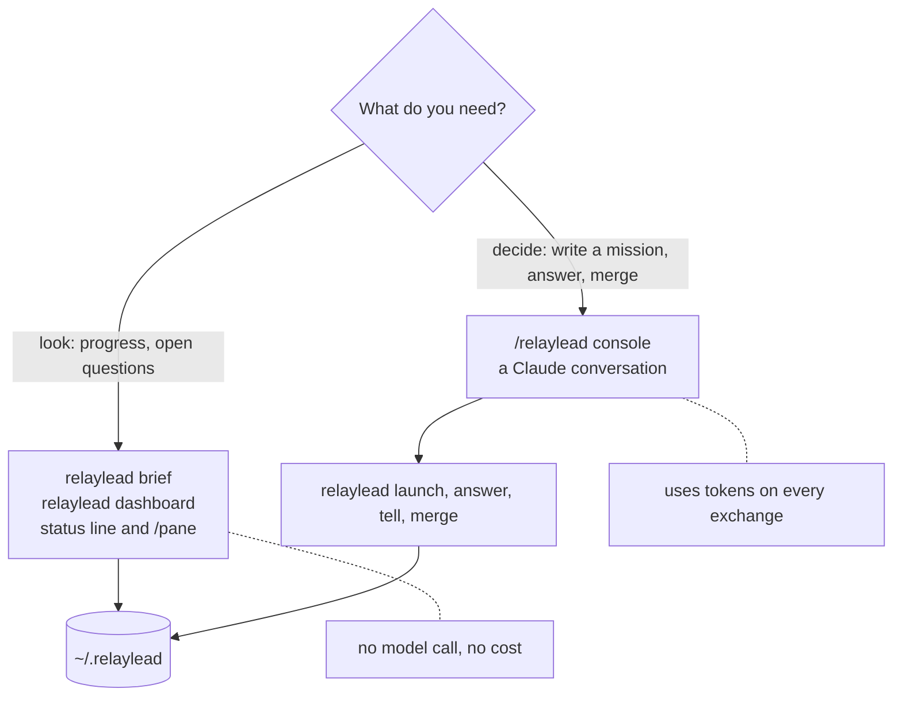

<strong>English</strong> · <a href="fr/how-it-works.md">Français</a>

# How Relaylead works

Relaylead is a command-line tool (`relaylead`) that starts and supervises Claude Code sessions running in the background (`claude --bg`). It keeps every piece of state in plain files under `~/.relaylead`, so a session, a conversation or the whole Mac can stop and start again without losing the mission. This page shows the moving parts as diagrams. The words are defined in the [glossary](guide.md#glossary).

## The big picture

- **You** talk to Relaylead through the console (a Claude Code conversation) or the terminal. Both run the same `relaylead` commands.
- **The lead** is one Claude Code session per mission. It never edits code: it reads the tasks, starts crew members, delivers their work and asks you questions, only through `relaylead` commands.
- **Crew members** are short-lived Claude Code sessions, one per task, each in its own worktree and on its own branch.
- **The watcher** is a plain Node.js loop with no AI. It makes sure the lead is alive and awake when something is waiting for it.
- **The files** in `~/.relaylead` are the single source of truth. A fresh lead reads them and carries on where the previous one stopped.

## A mission from start to finish

The [example from Getting started](getting-started.md#a-complete-mission-from-the-terminal): two tasks, `health` and `license`, where `license` asks a question first.

Each crew member works on its own: it reads its task, changes the code, runs the project's tests, commits on its branch, and ends with `relaylead task done` (or `task fail` with the reason). The lead delivers a done task by merging its branch into the integration branch, which makes the tasks that depend on it ready.

## Mission and task states

A mission:

A task:

A task with `ask` stays `todo` until you answer its question. "Skip this task" sets it aside for good.

## Branches and worktrees

Every mission works on branches of its own, so your checkout is never touched while it runs. Here is what the example looks like in git (the real branch names are `relaylead/hello-api/integration`, `relaylead/hello-api/health` and `relaylead/hello-api/license`):

- The integration branch starts from the branch you launched from, with its worktree in `.relaylead/worktrees/<mission>/_integration/`.
- Each task gets a branch from the integration branch and a worktree in `.relaylead/worktrees/<mission>/<task>/`. A crew member's file tools can only write there.
- Delivering a task merges its branch into the integration branch, then removes the task's worktree and branch.
- `relaylead merge` merges the integration branch into your branch. On a conflict, it cancels the merge, and a crew member resolves it on a branch of its own first.
- Git operations of different missions on the same repository take turns, under a lock.

## The watcher

The watcher is a loop of plain rules, with no model and no tokens spent. launchd keeps it alive across restarts of the Mac; `relaylead launch` also starts it. A pass runs every 5 minutes, and a short targeted pass runs right after an event (an answer, a finished task, a message).

| It sees | It does |
| --- | --- |
| A lead that stopped | Restarts it: the same session when its context is low, otherwise a fresh one that starts from the files. |
| A lead that ended its turn while an answer, a finished task or a message waits | Wakes it. |
| A lead whose context is full | Starts a fresh lead and stops the old one once it has written where things stand. |
| A second lead, or a crew session whose task no longer runs | Stops it. |
| A free place on the machine and queued tasks | Starts the queued task of the highest-priority mission. |
| Usage over the mission's threshold, or a usage limit | Pauses the mission and resumes it at the reset time. |
| 3 failed restarts in a row, or a billing or authentication error | Stops the mission, says why and notifies you. |
| A done mission whose integration branch was merged or deleted | Removes its state, task worktrees and task branches. |

Everything it does goes to `~/.relaylead/watcher.log`. An empty file `~/.relaylead/STOP` makes it do nothing until you remove it.

## The console and the terminal

The console and the terminal reach the same files. The difference is cost: the console is a Claude conversation, while `brief`, the web page and the status line only read files.

The console listens for events with `relaylead wait --all`, run as a background command: Claude Code wakes the conversation only when something happens, so a mission that runs for an hour costs nothing in the console while it runs. [Costs](costs.md#the-console-versus-brief-and-the-web-page) has the measured numbers.

## Where the state lives

| What | Where |
| --- | --- |
| Machine settings | `~/.relaylead/config.json` |
| A mission's state, tasks, questions, decisions, messages, journal | `~/.relaylead/missions/<mission>/` |
| The watcher's log | `~/.relaylead/watcher.log` |
| Project settings | `.relaylead.json` in the project |
| Project memory | `.relaylead/memory.md` in the project |
| Work in progress | `.relaylead/worktrees/<mission>/` and the `relaylead/<mission>/…` branches |

All writes are atomic and guarded by locks with the holder's process id, so two commands never corrupt a file, and a lock left by a dead process is taken over. The complete list is in [Files and folders](guide.md#files-and-folders).
